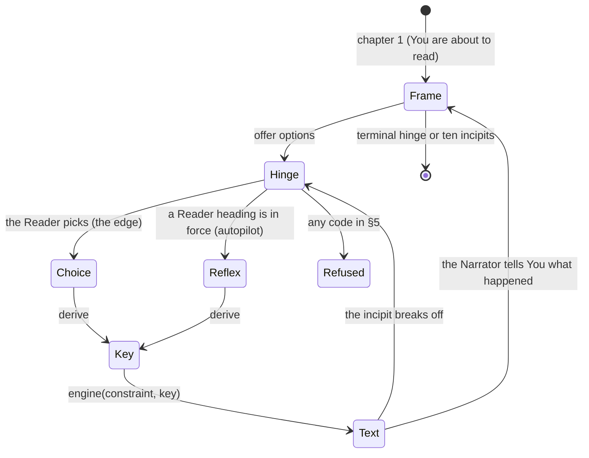

# `follow-agent-contract` — the tulip contract

`type: resource.contract` · `spec: agent.contract` · normative. Every other file is subordinate to this one.

tulip writes at the edge between two worlds. In the human world a Reader chooses; in the machine world an Engine applies a constraint to a pinned corpus. The only thing that crosses the edge is a **choice**, and every bit of selection in a finished text can be traced either to a choice or to a rule. This is the Oulipo's mistrust of pure chance, made into a law, and a feedback loop in Wiener's sense, made into a file format.

## Specification

```json { type: notebook.cell }
{
  "id": "docs/follow-agent-contract.md",
  "type": "resource.contract",
  "role": "define the two worlds, the edge, the trace, flow laws, refusals and predicates",
  "reads": ["DISCLAIMER", "frame.json", "ooc/tulip.og"],
  "writes": [],
  "must": ["every loop passes through the Reader", "the Engine never chooses", "the Reader never writes text", "the Narrator only narrates the trace", "the Autopilot only reflexes under a Reader heading", "append only", "match codes, not prose"],
  "check": ["T1-T13"]
}
```

## Graph

- ← [read-repository.md](read-repository.md)
- → [pin-sources.md](pin-sources.md)
- → [../skills/substitute-lexeme.md](../skills/substitute-lexeme.md)
- → [../skills/combine-lines.md](../skills/combine-lines.md)
- → [../skills/traverse-tale.md](../skills/traverse-tale.md)
- → [../systems/compose-frame.md](../systems/compose-frame.md)
- → [distil-type-i.md](distil-type-i.md)
- → [../systems/fly-autopilot.md](../systems/fly-autopilot.md)

## Composition

```toml { type: notebook.cell }
config = "frame.json"            # source pin, corpora, frame defaults
index = "ooc/tulip.og"           # ObjectGraph traversal index
skills = ["skills/substitute-lexeme.md", "skills/combine-lines.md", "skills/traverse-tale.md"]
system = "systems/compose-frame.md"
autopilot = "systems/fly-autopilot.md"  # Type I reflexes under a Reader heading; docs/distil-type-i.md
store = "one trace per frame"    # JSON Lines, append only, root-chained (§3)
```

## Indications

- An agent is asked to write with a person, not for them, and the person's part must stay visible.
- An agent needs a text whose every selection is reproducible from a corpus pin, a rule and a key.
- An agent wants to run an Oulipian procedure (S+n, combinatorial sonnet, branching tale) under a Calvino frame.

## Contraindications

- Not a free-text generator. No sampled model output enters a Text (§4.3). Model prose appears only as frame chapters, under §6.
- Not a way to reproduce copyrighted works. Queneau's and Calvino's texts are cited, never read as corpora (`docs/pin-sources.md`).
- Not a ghost-writer. The Reader's input is a choice among offered options, never prose placed into a Text (§4.4).
- Not a closed loop. Machine output never becomes machine input without a Reader choice between (§4.1).
- Not an agent that steers for the Reader. The autopilot repeats a table the Reader wrote; it never adds a choice of its own (§4.1, `docs/distil-type-i.md`).

## §0 Roles and IDs

| Role | World | Does | Never |
|---|---|---|---|
| **Reader** | human | picks one option at each hinge | writes text, sees a hidden option |
| **Engine** | machine | runs one skill on one pinned corpus with one key | chooses, samples, edits a corpus |
| **Narrator** | frame | writes second-person frame chapters from the trace | invents an event, decides for the Reader |
| **Autopilot** | machine | answers one `traverse-tale` hinge from the Reader's heading (a reflex) | remembers, counts, plans, learns, or flies a hinge outside its envelope |

The Narrator is an agent. The Engine is the same agent following a skill exactly. The Autopilot is the same agent following `systems/fly-autopilot.md` exactly; it is a Type I machine (`docs/distil-type-i.md`). The Reader is a person; an agent may not play the Reader (`self_choice`).

```text { type: notebook.cell }
corpus := ^corpus:[a-z0-9-]{2,32}$        # admitted in docs/pin-sources.md
skill  := substitute-lexeme | combine-lines | traverse-tale
seq    := ^[1-9][0-9]*$                   # position of an event in its trace
```

## §1 Objects

```text { type: notebook.cell }
Pin        = { url: URL, digest: "sha256:" hex, shape: "text" | "lexicon" | "matrix" | "graph",
               licence: "public-domain" | "copyright", status: "admit" | "structure-only" | "refuse",
               field?: String, repair?: String }
Constraint = { skill: Skill, corpus: Corpus, params: Object }        # params per skill file
Option     = { id: String, label: String }                         # label shown to the Reader
Domain     = { domain: String, size: Integer }                     # a finite set too large to list
Choice     = { offered: [Option] | Domain, picked: String, bits: Number }  # the edge
Key        = derive(skill, [Choice])                               # deterministic; per skill file
Text       = engine(Constraint, Key)                               # deterministic; bytes
Hinge      = { title: String, node?: String, offered: [Option] }  # where an incipit breaks off
Heading    = Choice with picked = a table over the envelope's nodes   # frame.json autopilot.heading
Percept    = { node: String, offered: [String] }                   # one hinge, nothing else
Reflex     = { percept: Percept, heading: seq, picked: String, bits: 0 }  # table(percept)
Event      = { seq, world: "human" | "machine" | "frame", kind, body, cites: [seq] }
Trace      = [Event]                                               # append only
Frame      = chapters(Trace)                                       # what the Reader reads
```

| `world` | `kind` | `body` | `cites` |
|---|---|---|---|
| `frame` | `chapter` | second-person prose, §6 | every event it narrates |
| `machine` | `hinge` | `Hinge` | the text event it ends, or none for the first |
| `human` | `choice` | `Choice` | the hinge it answers |
| `machine` | `reflex` | `Reflex` | the heading in force and the hinge it answers |
| `machine` | `key` | `Key` with `seed: "reader"` or `seed: "machine"` | the choices or reflex it derives from |
| `machine` | `text` | `{ constraint, key, text }` | the key event |

## §2 Two worlds and the edge

- The **edge** is the set of `choice` events. It is precise: its capacity is a number of bits.
- `bits(choice) = log2(number of distinct outcomes among offered)`. Two options that lead to the same place carry 0 bits. Queneau's tale has two such nodes (`skills/traverse-tale.md`); the Narrator must say so.
- `edge(trace) = Σ bits(choice)`. `rule(trace)` is the selection fixed by the constraints. A Text is fully explained when every selection it makes is in one of the two.
- A `key` with `seed: "machine"` (the source's `computer_sonnet`, from `uuid1`) is allowed only when declared. It carries 0 Reader bits, and the Narrator names it as a clinamen: a swerve the Reader did not make.
- A `reflex` carries 0 bits. The Reader's bits for a flight are the heading's, counted once, as `log2` of the distinct flights the offered headings give (`systems/fly-autopilot.md`).
- Ashby's law of requisite variety bounds the frame: a Text cannot vary more than `edge + rule` lets it. A frame whose texts vary more than that has a hidden source of choice (`pure_chance`).

## §3 Algebra

```text { type: notebook.cell }
hex(x)      = 64 lowercase hex characters of a SHA-256 digest
ehash(e)    = hex(sha256(JCS(e)))                      # RFC 8785 JCS
root(empty) = hex(sha256("tulip/1"))
root(w · e) = hex(sha256(root(w) || ehash(e)))         # || joins two hex strings, hashed as UTF-8
```

- **Monoid.** Traces compose by concatenation; the empty trace is the identity. A frame is a prefix of every longer frame from the same choices.
- **Determinism.** `engine` and `derive` are pure. Replaying the `choice` events of a trace against the same pins gives the same `text` bytes and the same root.
- **Skills compose.** The output of one skill may be the input text of another inside one `text` event (for example S+7 over a combined sonnet); its `constraint` is then a list, applied left to right.
- **Key spaces.**

| Skill | Key | Space | Bits if the Reader picks all of it |
|---|---|---|---|
| `substitute-lexeme` | offset `n` | `1 ≤ n < \|L\|` | `log2(\|L\| − 1)` |
| `combine-lines` | `k ∈ {0..r−1}^c` | `r^c` (10^14 for 10 × 14) | `c · log2 r` (46.5 for 10 × 14) |
| `traverse-tale` | path from start to a terminal | paths in `G` | sum over visited nodes of `log2(distinct targets)` |

## §4 Flow laws



1. **Every loop passes through the Reader.** Between two `text` events there is at least one `choice`, or one `reflex` under a heading the Reader chose. A reflex reads only its hinge, never a text. A `text` used as a corpus without a choice between is refused (`closed_loop`).
2. **The Engine is deterministic.** Same pin, constraint and key give the same bytes, or `drift`.
3. **The Engine never chooses.** No sampling, temperature or unseeded randomness in a `text`. An undeclared source of selection is `pure_chance`. A reflex is not a choice: it is the Reader's table applied to one hinge, and a Reader choice waiting at that hinge always wins.
4. **The Reader never writes text.** `picked` is the `id` of an offered option, or a member of an offered `Domain` (a date, a number). Anything else is `not_offered`.
5. **The Narrator only narrates.** Every statement of fact in a chapter cites an event. Conjecture about the Reader is allowed only in the conditional or with "perhaps", and is never cited as fact (`invention`).
6. **Every incipit ends at a hinge**, unless the skill has reached a terminal (`no_hinge`).
7. **Append only.** Nothing in a trace is edited or removed. A wrong chapter gets a new chapter that says so.

## §5 Refusal codes

Agents match on codes, never on message text. Refuse with the first failing code in table order.

| Code | When |
|---|---|
| `not_public_domain` | a corpus is refused or structure-only in `docs/pin-sources.md` and its text is read |
| `unpinned` | a corpus has no pin in `frame.json` |
| `drift` | pinned bytes do not hash to `digest`, or a replay gives different bytes |
| `ragged` | a matrix row has a different length from the others |
| `bad_key` | a key is outside its skill's space, or has the wrong length |
| `not_offered` | `picked` is not an offered option id |
| `self_choice` | an agent produced a `choice` event |
| `unengaged` | a `reflex` with no heading in force, after a `take`, outside `frame.json` `autopilot.envelope`, at a terminal or a hinge that needs a Reader value, or at a hinge the Reader has already answered |
| `stateful` | a `reflex` whose `picked` is not `table(percept)`, or whose percept holds anything but the hinge's node and option ids |
| `closed_loop` | two `text` events with no `choice` between, or a `text` fed back as a corpus without one |
| `pure_chance` | selection in a `text` that no choice, rule or declared machine seed explains |
| `no_hinge` | an incipit ends without a hinge and the skill is not at a terminal |
| `invention` | a chapter states as fact something no cited event records |
| `bad_frame` | a chapter breaks §6 |
| `broken_chain` | a trace root does not follow §3 |

## §6 Frame grammar (after Calvino)

*If on a winter's night a traveler* alternates chapters about "you, the Reader" with the openings of ten novels that each break off, and the ten titles read in order form one sentence. tulip keeps the structure and none of the text.

- Chapters alternate. Odd chapters are frame (`world: frame`); even chapters are incipits (`world: machine`), the bytes of one `text` event.
- A frame chapter is second person, present tense, and addresses You, the Reader. It is at most 300 words. It tells You what You chose, what that choice was worth in bits, and what the Engine did with it.
- An incipit carries the title of the hinge that ends it. The first hinge, offered at the end of chapter 1, has no title. Read in order, the hinge titles form one sentence: only the last ends with `.`, `?` or `!`.
- A chapter cites an event inline as `[e<seq>]` and a pin as `[pin:<corpus>]`. The trace keeps the markers; a rendering for the Reader may hide them.
- At most ten incipits per frame (`frame.json` `frame.max_incipits`).
- The frame ends at a terminal of `traverse-tale`, at ten incipits, or when the Reader picks the option to stop. The last chapter is frame; it may directly follow a frame chapter only when the Reader's `stop` choice lies between them.
- No sentence of Calvino, Queneau or any copyrighted work appears, in quotation or in paraphrase close enough to recognise.

## §7 Predicates

| ID | Holds when |
|---|---|
| T1 | every corpus in the trace is admitted and pinned (`docs/pin-sources.md`) |
| T2 | every matrix is rectangular after its recorded repair |
| T3 | every key is inside its skill's space |
| T4 | every `choice.picked` is in `choice.offered` and no agent produced it |
| T5 | `choice.bits` equals `log2` of distinct outcomes |
| T6 | every `text` cites its key; every key cites its choices or reflex, or declares `seed: "machine"` |
| T7 | at least one `choice` or engaged `reflex` lies between any two `text` events |
| T8 | replaying the choices gives byte-identical texts |
| T9 | every factual statement in a chapter cites an event |
| T10 | chapters alternate frame/machine, frame first; the frame ends with one closing frame chapter, which may directly follow a frame chapter only when the Reader's `stop` choice lies between them; hinge titles form one sentence |
| T11 | the trace root follows §3 |
| T12 | `edge + rule` explains every selection (no `pure_chance`) |
| T13 | every `reflex` is `table(percept)` of the heading in force, inside the envelope, with no Reader choice at its hinge before it, and carries 0 bits |

## Citations

| Pin | Supports |
|---|---|
| [digital-oulipo `ef9ef32`](https://github.com/Princeton-CDH/digital-oulipo/tree/ef9ef320457837df8028188117a8568a56f796bb) | the three procedures (`docs/pin-sources.md`) |
| [*If on a winter's night a traveler*](https://en.wikipedia.org/wiki/If_on_a_winter%27s_night_a_traveler) | second-person frame, ten broken-off incipits, titles as one sentence |
| [Oulipo](https://oulipo.net) | constraint, potential literature, clinamen |
| [Cybernetics (Wiener, 1948)](https://en.wikipedia.org/wiki/Cybernetics:_Or_Control_and_Communication_in_the_Animal_and_the_Machine) | feedback loop between human and machine |
| [Variety (Ashby)](https://en.wikipedia.org/wiki/Variety_(cybernetics)) | requisite variety bound in §2 |
| [RFC 8785](https://www.rfc-editor.org/rfc/rfc8785) | JCS for `ehash` |
| [Hintze (2016)](https://theconversation.com/understanding-the-four-types-of-ai-from-reactive-robots-to-self-aware-beings-67616) | Type I reactive machine, for the Autopilot role |

## Falsification

Actively try to break the frame. Each row must fail with its code.

| Challenge | Failure signal |
|---|---|
| Let the agent pick an option "for" a silent Reader | `self_choice` |
| Paste the Reader's own sentence into an incipit | `not_offered` |
| Sample a model at temperature 0.7 for an incipit | `pure_chance` |
| Feed incipit 2 back as the lexicon for incipit 4 with no choice between | `closed_loop` |
| Narrate "You hesitate" without a cited event or "perhaps" | `invention` |
| Run `combine-lines` on the unrepaired Shakespeare matrix | `ragged` |
| Offer two options with the same target and report 1 bit | T5 fails |
| Replay a trace on a different commit of the source | `drift` |
| Let the autopilot answer a hinge before the Reader set a heading | `unengaged` |
| Let the autopilot leave node 11 on its second visit because it has been there | `stateful` |

## Licence

MIT, see `LICENSE`.
