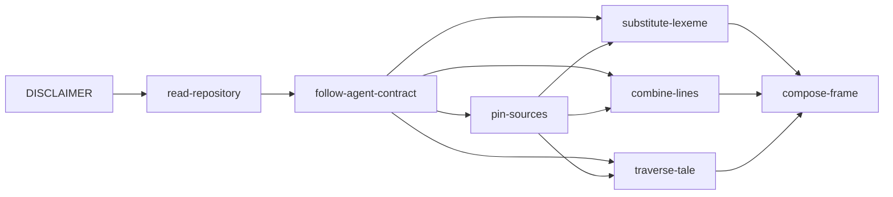

# `read-repository` — route an agent

`type: resource.router` · `spec: agent.router` · non-normative; `docs/follow-agent-contract.md` governs on any conflict.

tulip is a cybernetic writing engine. It is a specbase: an agent reads these files at run time and composes a writing frame in which a human Reader and a machine Engine take turns, and the only thing that crosses between them is a choice. There is no app and no server.

## Specification

```json { type: notebook.cell }
{
  "id": "docs/read-repository.md",
  "type": "resource.router",
  "role": "send each task down the smallest sufficient path",
  "reads": ["DISCLAIMER", "task"],
  "writes": [],
  "must": ["read DISCLAIMER first", "load the contract before any skill", "stop at the first sufficient row"],
  "check": ["route row exists", "Graph reciprocity"]
}
```

## Graph

- → [follow-agent-contract.md](follow-agent-contract.md)

## Route

Read `DISCLAIMER` before any node. Then take the first row that covers the task and stop.

| Task | Path |
|---|---|
| Compose a whole frame with a Reader | contract → `systems/compose-frame.md` |
| Swap nouns by a fixed offset (S+n) | contract → `skills/substitute-lexeme.md` |
| Build a poem from a key over a line matrix | contract → `skills/combine-lines.md` |
| Walk a branching tale | contract → `skills/traverse-tale.md` |
| Check whether a corpus may be used | `docs/pin-sources.md` |
| Audit or replay a finished trace | contract §7 → `systems/compose-frame.md` §Replay |
| Traverse without reading prose | `ooc/tulip.og` |
| Anything else, or a conflict | `docs/follow-agent-contract.md` |

## Reading order



## Licence

MIT, see `LICENSE`. Corpora are cited where used, not vendored.
